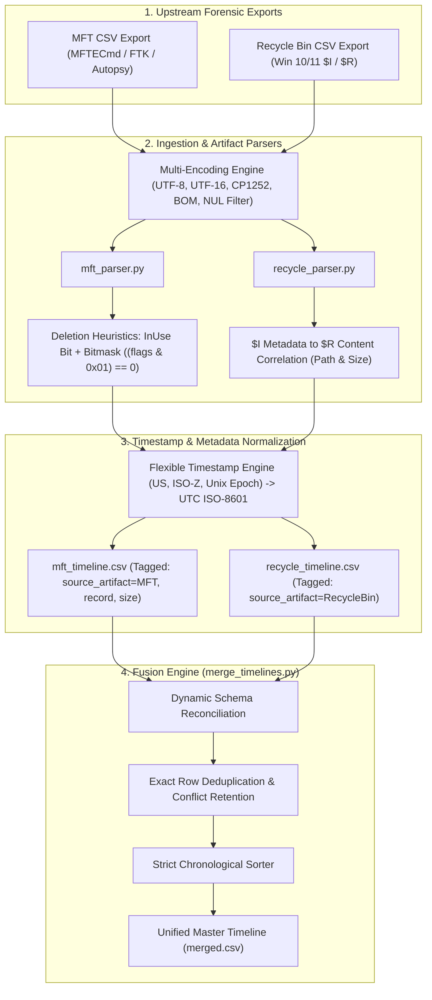

# Disk Forensics — NTFS MFT & Recycle Bin Timeline Reconstruction

A modular forensic toolset for ingesting, normalizing, and correlating Windows file-system artifacts (NTFS Master File Table and Recycle Bin `$I`/`$R` records) to reconstruct chronological user and system activity timelines.

---

## 1. Overview & Purpose

During disk forensics investigations, determining the exact sequence of file creations, modifications, accesses, and intentional deletions is critical for establishing timeline evidence (e.g. data exfiltration, anti-forensics wiping, malware staging).

`disk_forensics` processes heterogeneous CSV exports from forensic triage tools (such as Autopsy, FTK Imager, MFTECmd), resolves encoding issues, applies heuristic deletion detection, normalizes alternate timestamp formats, and fuses multiple artifact sources into a unified chronological master timeline.

---

## 2. Architecture & Pipeline



---

## 3. Key Capabilities

1. **Multi-Encoding Ingestion:** Robust fallback support for UTF-8-SIG (BOM), UTF-16LE, CP1252, and Latin-1 exports commonly generated by Windows-based triage tools, with embedded NUL byte cleansing.
2. **Flexible Timestamp Parsing:** Normalizes standard dates, US formats (`MM/DD/YYYY HH:MM:SS`), ISO-8601 with `Z` timezone and microsecond offsets, and Unix epoch timestamps (seconds or milliseconds) into standardized UTC ISO-8601 strings.
3. **Heuristic Deletion Identification:** Identifies unallocated or marked-for-deletion MFT records via `InUse` status, textual flags, and numeric bitmasks (`(flags & 0x01) == 0`).
4. **Source Artifact & Metadata Tracking:** Explicitly tags records with `source_artifact` (`MFT` vs `RecycleBin`), preserving MFT record numbers and file sizes through timeline extraction and merger.
5. **Conflict Resolution & Deduplication:** Preserves contradictory metadata by retaining source tags and removes byte-for-byte duplicate entries without schema fragmentation.
6. **Chronological Timeline Fusion:** Integrates heterogeneous schemas into a unified, cleanly ordered master timeline sorted strictly by event timestamp.

---

## 4. Directory Structure

```
disk_forensics/
├── mft_parser.py             # Parses MFT CSV exports & normalizes timestamps
├── recycle_parser.py         # Parses Recycle Bin metadata & original paths
├── merge_timelines.py        # Reconciles heterogeneous schemas & sorts chronologically
├── requirements.txt          # Python dependencies (python-dateutil)
├── DOCUMENTATION.md          # In-depth forensic background & interview talking points
├── README.md                 # Module technical manual
├── sample_mft.csv            # Test MFT artifact export
├── sample_recycle.csv        # Test Recycle Bin artifact export
├── mft_report.csv            # Generated normalized MFT analysis
├── mft_timeline.csv          # Generated MFT event timeline
├── recycle_report.csv        # Generated Recycle Bin analysis
├── recycle_timeline.csv      # Generated Recycle Bin event timeline
├── merged.csv                # Generated unified master timeline
└── tests/
    └── test_disk_forensics.py# Automated unit & integration tests (11 test cases)
```

---

## 5. Installation & Prerequisites

Python 3.10+ and `python-dateutil`:

```powershell
py -m pip install -r requirements.txt
```

---

## 6. CLI Usage & Real Execution Examples

### A. Parse Master File Table (MFT) CSV
```powershell
py mft_parser.py sample_mft.csv
```
**Sample Output:**
```
[INFO] Successfully parsed 4 records from sample_mft.csv
[INFO] Normalized MFT report written to: .\mft_report.csv
[INFO] MFT timeline written to: .\mft_timeline.csv
```

### B. Parse Recycle Bin CSV
```powershell
py recycle_parser.py sample_recycle.csv
```
**Sample Output:**
```
[INFO] Successfully parsed 3 Recycle Bin records from sample_recycle.csv
[INFO] Recycle Bin report written to: .\recycle_report.csv
[INFO] Recycle Bin timeline written to: .\recycle_timeline.csv
```

### C. Merge Timelines into Unified Master Timeline
```powershell
py merge_timelines.py mft_timeline.csv recycle_timeline.csv -o merged.csv
```
**Sample Output:**
```
[INFO] Loaded 12 events from mft_timeline.csv
[INFO] Loaded 3 events from recycle_timeline.csv
[INFO] Wrote 15 chronological events to: merged.csv
```

**Unified Master Timeline Schema (`merged.csv`):**
```csv
timestamp,source_artifact,event,filename,record,size,fullpath,original_path,recycle_name,flags,deleted
2024-11-27 09:16:44,MFT,created,image.png,1001,204800,C:\Users\Admin\Pictures\image.png,,,InUse,False
2024-11-28 14:15:00,MFT,modified,image.png,1001,204800,C:\Users\Admin\Pictures\image.png,,,InUse,False
2024-11-29 20:44:10,RecycleBin,deleted,holiday.jpg,,153600,,C:\Users\Admin\Pictures,$R104.jpg,,
2024-12-01 11:05:31,MFT,created,secret.txt,1002,4096,C:\Users\Admin\Desktop\secret.txt,,,Deleted,True
2024-12-01 11:10:45,RecycleBin,deleted,secret.txt,,4096,,C:\Users\Admin\Desktop,$R103.txt,,
```

---

## 7. Sample Use Cases

1. **Malware Staging Detection:** Correlating file drop events in MFT with rapid access and subsequent deletion into the Recycle Bin to identify automated dropper scripts.
2. **Insider Threat Exfiltration Tracking:** Tracing when confidential archives were created in user profiles, accessed, and cleared from the Recycle Bin prior to employee departure.
3. **Anti-Forensics Assessment:** Identifying discrepancies between `$STANDARD_INFORMATION` and `$FILE_NAME` timestamps to flag timestomping activity.

---

## 8. Forensic Limitations & Caveats

> [!WARNING]
> **Heuristic Deletion Note:** In NTFS, clearing the `InUse` bit (`0x01`) indicates that the MFT entry has been marked unallocated by the operating system.
> - An unallocated MFT record can be reused or overwritten quickly on active partitions.
> - A deleted flag does not guarantee resident or non-resident data clusters are intact.
> - Corroborate MFT flags with the NTFS **$LogFile**, **$UsnJrnl**, and Volume Shadow Copies.

> [!NOTE]
> **Limitations of CSV-Based NTFS Reconstruction:**
> - Exporting MFT metadata to CSV relies on upstream triage parsers.
> - CSV exports omit low-level filesystem structures such as Alternate Data Streams (ADS), non-resident data run lists, and MFT update sequence fixup values.
> - High-concurrency events may exhibit timestamp collusions depending on the precision of the upstream tool export.

---

## 9. Running Automated Tests

```powershell
py -m unittest tests/test_disk_forensics.py
```
Validates deletion heuristics, alternate timestamp parsers (US, ISO-Z, Unix epoch), NUL-byte handling, schema merging, conflict retention, and encoding support (11 tests).
